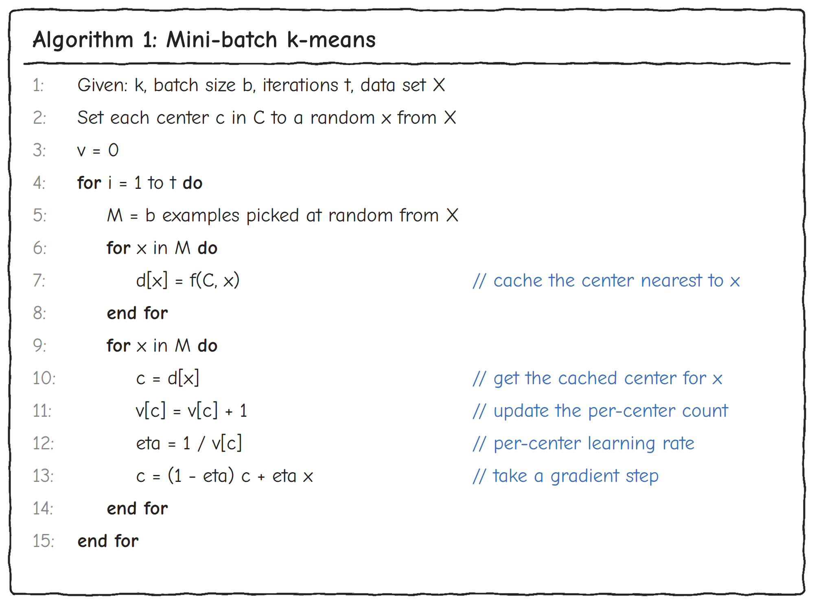

# minibatch-kmeans


minibatch-kmeans is mini-batch k-means clustering for PyTorch tensors. The package follows Sculley's *[Web-Scale K-Means Clustering](https://doi.org/10.1145/1772690.1772862)* (WWW 2010). scikit-learn's [`MiniBatchKMeans`](https://scikit-learn.org/stable/modules/generated/sklearn.cluster.MiniBatchKMeans.html) uses the same algorithm, but it runs on CPU only.

## Features

- **CPU and GPU support.** The model works directly on PyTorch tensors, on any device.
- **Training on new data.** `partial_fit` updates the model one batch at a time, so your full dataset never has to fit in memory.
- **Save and load.** You can save a model and continue training it later.

You can read the full API reference at [mb-14.github.io/minibatch-kmeans](https://mb-14.github.io/minibatch-kmeans/).

## How it works

Each training step picks a small random batch of points. Each point is assigned to its nearest center, and then each center moves toward the points assigned to it. Every center keeps a count of the points it has seen. Its learning rate is 1 divided by that count, so the center is always the average of all the points it has received, and it moves less as training goes on.



*Adapted from Algorithm 1 in D. Sculley, [Web-Scale K-Means Clustering](https://doi.org/10.1145/1772690.1772862), WWW 2010.*

## Install

You need Python 3.10 or newer. Install a PyTorch 2.x build for your machine first, using the selector on [pytorch.org](https://pytorch.org/get-started/locally/). Then install the package:

```bash
pip install minibatch-kmeans
```

## Quick start

### Fit a tensor

```python
import torch
from minibatch_kmeans import MiniBatchKMeans

X = torch.randn(5000, 4, dtype=torch.float32)

km = MiniBatchKMeans(n_clusters=8, random_state=torch.Generator().manual_seed(42))
km.fit(X, batch_size=256, max_iter=20)
labels = km.predict(X)

print(labels.shape)              # torch.Size([5000])
print(km.cluster_centers.shape)  # torch.Size([8, 4])
```

`fit` returns the centers, and `predict` returns one label per row. `fit_predict` does both steps in one call. The input dtype must match the model's `dtype`, which is `torch.float32` by default. Pass a seeded CPU `torch.Generator` as `random_state` when you need the same result on every run.

### Run on a GPU

Set `device` on the model and move your data to the same device:

```python
km = MiniBatchKMeans(n_clusters=8, device=torch.device("cuda"))
labels = km.fit_predict(X.cuda(), batch_size=256)
```

### Train on new batches

`partial_fit` updates the centers with every row of the batch you pass in. Use it when data arrives as a stream or does not fit in memory.

```python
km = MiniBatchKMeans(n_clusters=8)
for batch in X.split(256):
    km.partial_fit(batch)
labels = km.predict(X)
```

The notebook [notebooks/partial_fit_demo.ipynb](notebooks/partial_fit_demo.ipynb) walks through this step by step.

### Save and load a model

```python
km.save("kmeans.pt")

km2 = MiniBatchKMeans.load("kmeans.pt")                                  # loads on CPU
km_gpu = MiniBatchKMeans.load("kmeans.pt", device=torch.device("cuda"))  # loads on a GPU
```

> [!WARNING]
> `load` uses `torch.load` without `weights_only`, so it can run code stored in the file. Load only files you trust.

## Benchmarks

See [evaluation/README.md](evaluation/README.md).

## Development

Install the package in editable mode with the `dev` extra, then run the tests:

```bash
conda run -n kmeans-bench pip install -e ".[dev]"
conda run -n kmeans-bench python -m unittest discover -s tests -v
```

To build the API docs locally into `pdoc_html/`, run:

```bash
conda run -n kmeans-bench bash scripts/gen_api_docs.sh
```

## License

This project uses the [MIT License](LICENSE).
