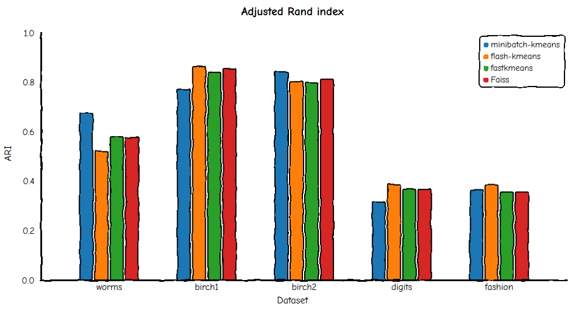
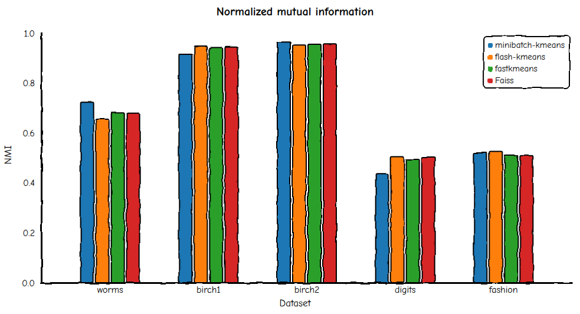
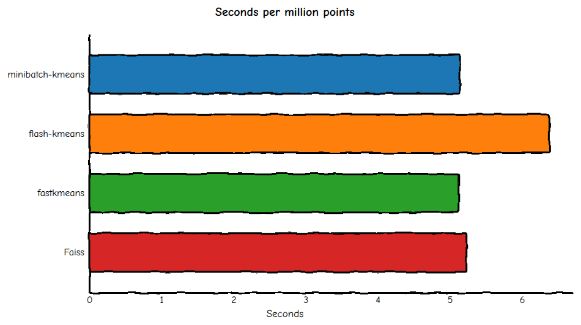
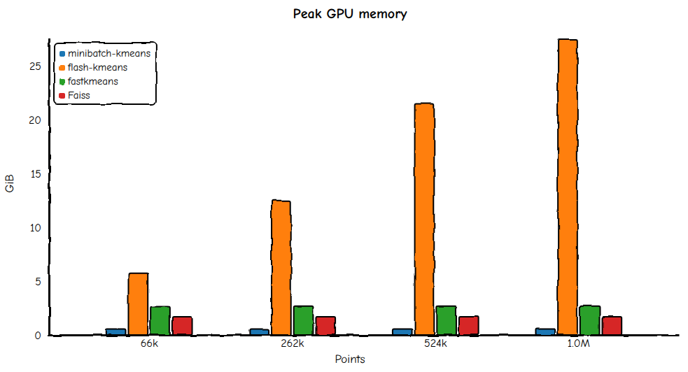

# Benchmarks and evaluation

This page compares minibatch-kmeans with [flash-kmeans](https://github.com/svg-project/flash-kmeans), [fastkmeans](https://github.com/AnswerDotAI/fastkmeans), and [Faiss](https://github.com/facebookresearch/faiss) on one GPU. It also shows you how to rerun the comparison.

## Clustering quality

Quality comes from the [clustering-benchmarks](https://clustering-benchmarks.gagolewski.com/) suite, version 1.1.0. Each method runs three times, with seeds 42, 43, and 44. For each run, we keep the best match against the reference labels. Each bar shows the mean of those three scores. Scores run from 0 to 1, and higher is better.

Two scores measure the match:

- The adjusted Rand index (ARI) checks how often pairs of points land in the same group in both labelings. It is corrected so that random labels score about 0.
- Normalized mutual information (NMI) measures how much the predicted labels tell you about the reference labels.

The datasets are listed in [`presets.py`](presets.py):

| Dataset | Points | Features | Contents |
| --- | --- | --- | --- |
| `worms_64` | 105,000 | 64 | Worm-shaped outlines stored as coordinates |
| `birch1` | 100,000 | 2 | Synthetic Gaussian clusters |
| `birch2` | 100,000 | 2 | The same family as `birch1`, with a different layout |
| `digits` | 70,000 | 719 | Flattened MNIST digits |
| `fashion` | 70,000 | 784 | Flattened Fashion-MNIST images |

minibatch-kmeans uses batches of 16,384 points and a reassignment ratio of 0.1. The reassignment ratio controls when small clusters are moved to new starting points. Every method uses the same number of iterations on a given dataset.



On ARI, the four methods score in a similar range on each dataset. The leading method changes from one dataset to the next.



On NMI, the methods again score close together on each dataset. The order differs from the ARI chart, which is why the two scores have separate charts.

## Speed and memory

The speed test uses a synthetic Gaussian mixture with 512 clusters and 4,096 features. Each method runs 5 iterations on 75% of the points, and only the fit is timed. minibatch-kmeans uses batches of 16,384 points and a reassignment ratio of 0.01. For flash-kmeans, the test page-locks the input matrix in CPU memory, discards two warm-up runs, and reports the mean of the next two runs.



The time per point has leveled off by 1,048,576 points, so the chart shows only that size. minibatch-kmeans, fastkmeans, and Faiss each take 5.1 to 5.2 seconds per million points. flash-kmeans takes 6.4 seconds.



minibatch-kmeans peaks at 0.56 GiB of GPU memory at every size. Faiss stays at 1.7 GiB, and fastkmeans stays near 2.7 GiB. flash-kmeans grows with the number of points, from 5.7 GiB at 65,536 points to 27.5 GiB at 1,048,576 points.

## Reproduce the benchmarks

You need a CUDA GPU and [conda](https://docs.conda.io/). Run every command from the repository root, not from this folder.

1. Create the `kmeans-bench` environment:

   ```bash
   conda create -n kmeans-bench python=3.11
   ```

2. Install the package with the `eval` extra, then install Faiss from conda-forge. Faiss is not part of the `eval` extra.

   ```bash
   conda run -n kmeans-bench pip install -e ".[eval]"
   conda install -n kmeans-bench -c conda-forge faiss-gpu
   ```

3. Download the benchmark data. [`scripts/setup_eval.sh`](../scripts/setup_eval.sh) clones [clustering-data-v1](https://github.com/gagolews/clustering-data-v1) at tag v1.1.0 into `./clustering-data-v1`.

   ```bash
   conda run -n kmeans-bench bash scripts/setup_eval.sh
   ```

4. Run the quality suite. The results go to `results_eval.json`.

   ```bash
   conda run -n kmeans-bench python -m evaluation.run \
     --data-path ./clustering-data-v1 \
     --device cuda:0 \
     --methods minibatchkmeans flashkmeans fastkmeans faisskmeans \
     --batch-size 16384 \
     --reassignment-ratio 0.1 \
     --n-trials 3 \
     -o results_eval.json
   ```

   You can also add `sklearnkmeans` and `sklearnminibatchkmeans` to `--methods` to compare against scikit-learn on CPU.

5. Run the speed test for one method. The settings below match the speed chart. Change `--method` to `flashkmeans`, `fastkmeans`, or `faisskmeans` to time the other methods.

   ```bash
   conda run -n kmeans-bench python -m evaluation.perf_test \
     --device cuda:0 \
     --n 1048576 \
     --k 512 \
     --d 4096 \
     --niter 5 \
     --method minibatchkmeans \
     --batch-size 16384 \
     --reassignment-ratio 0.01 \
     -o results.json
   ```

Run `python -m evaluation.run --help` or `python -m evaluation.perf_test --help` to see every option.
